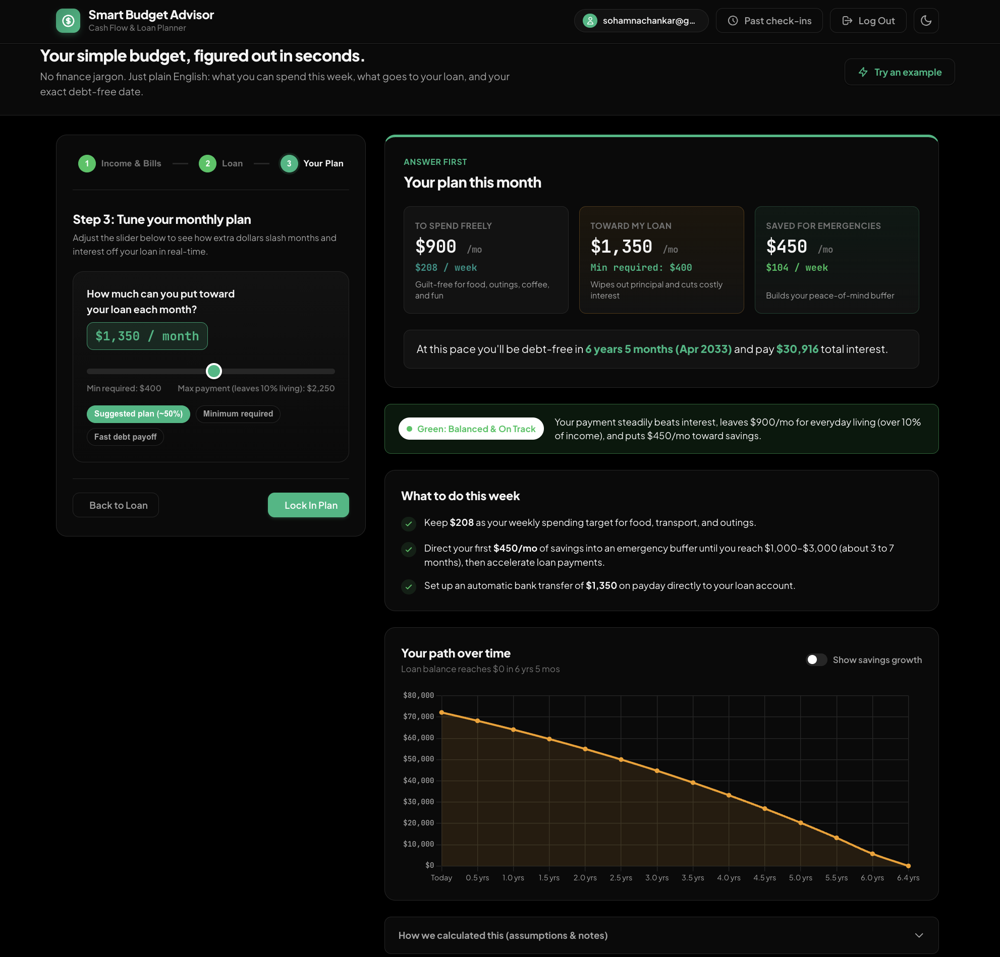
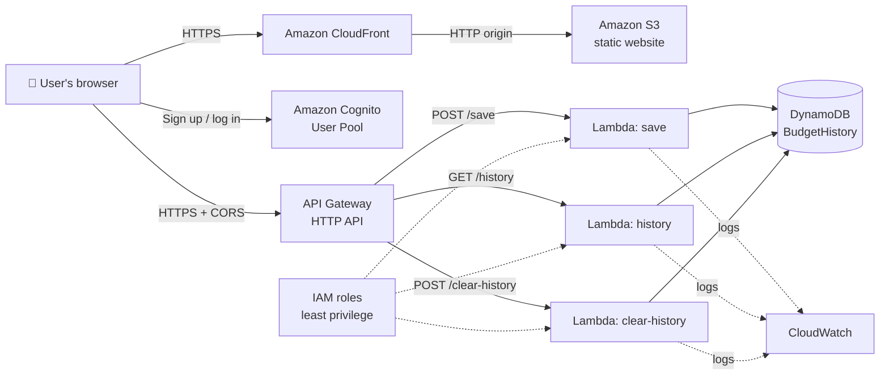
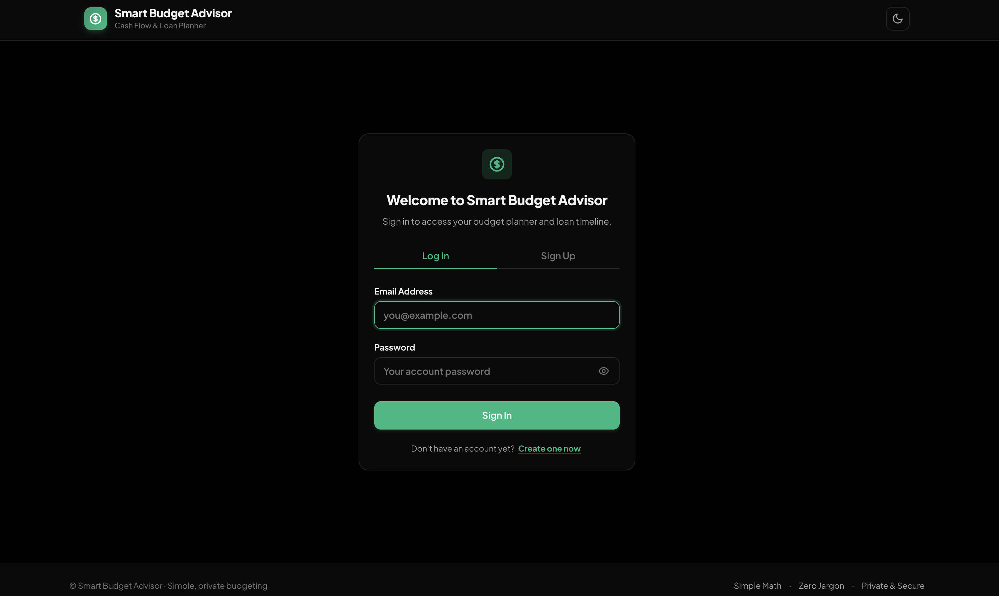
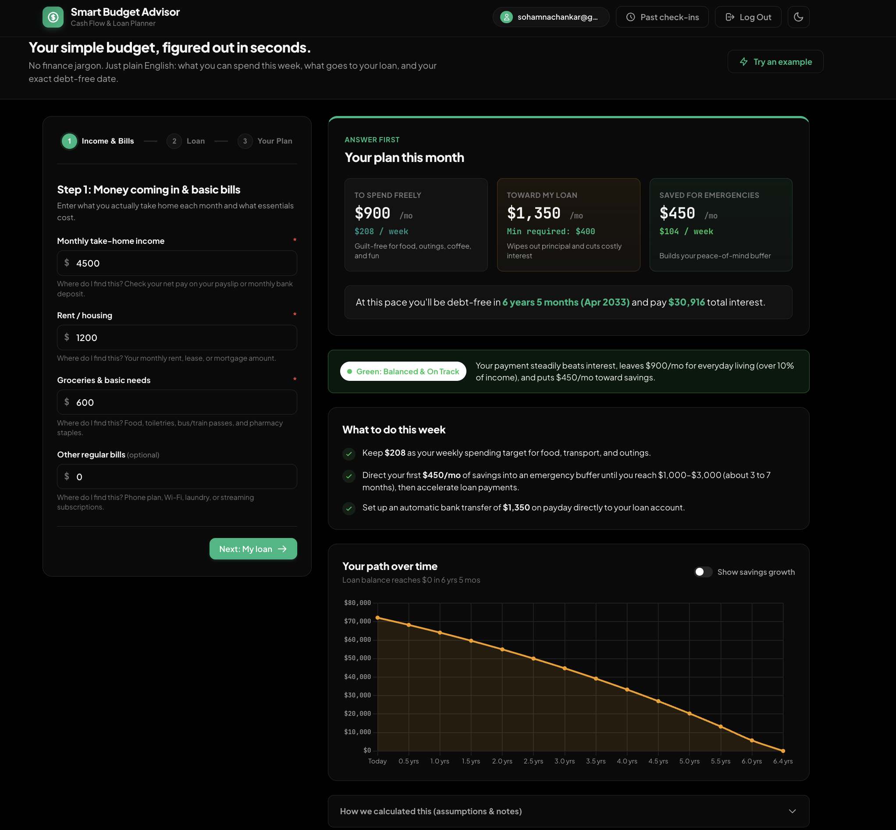
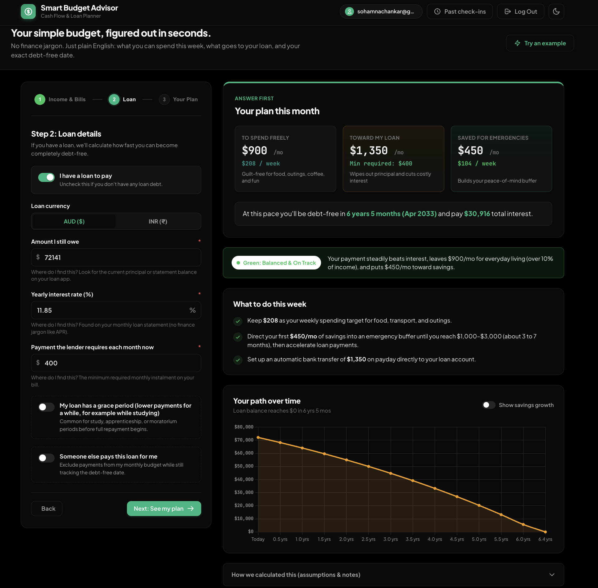
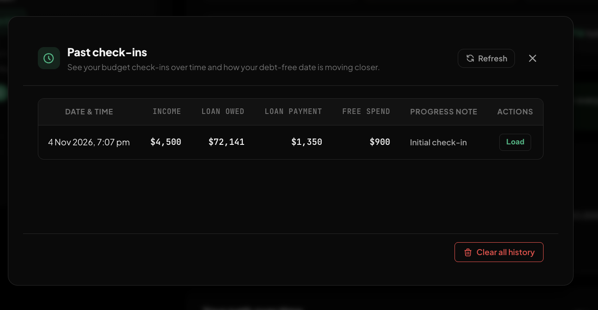

# 💸 Smart Budget Advisor

### A serverless budgeting and loan-payoff app, built end to end on AWS

**[▶ Try the live app](https://d2mwk2cqloy1gp.cloudfront.net)**

---

## 👋 For recruiters: the 30-second summary

I built and deployed this app myself to learn AWS by doing. It is a real, working, publicly hosted product, not a tutorial copy.

| What it shows | Evidence in this project |
|---|---|
| **I can design a serverless architecture** | S3 + CloudFront → Cognito → API Gateway → Lambda → DynamoDB, all wired together by hand in the console |
| **I understand AWS security basics** | Cognito user auth, least-privilege IAM policies, CORS locked to one origin, HTTPS everywhere, no secrets in code |
| **I can debug cloud problems** | Fixed CloudFront caching issues, S3 website-endpoint protocol limits, CORS errors and API route mistakes (see [Problems I solved](#-problems-i-solved)) |
| **I think about cost** | AWS Budgets zero-spend alert, no always-on servers, pay-per-request services only |
| **I can build the front end too** | Responsive vanilla JS app with a real loan-amortisation engine, charts, and light/dark themes |
| **I know what's still missing** | I documented a known security gap and my plan to close it ([Roadmap](#-roadmap)) |

> **Currently preparing for AWS certification.** This project is how I turn the exam topics into hands-on experience.

---

## ☁️ AWS services used

| Service | Role in this project | What I learned |
|---|---|---|
| **Amazon S3** | Hosts the static site (HTML, CSS, JS) | Static website hosting, bucket configuration, object metadata and `Content-Type` |
| **Amazon CloudFront** | Serves the site over HTTPS from edge locations | Custom origins, why the S3 *website endpoint* needs HTTP-only, cache invalidation, WAF cost trade-offs |
| **Amazon Cognito** | User sign-up, email verification, login | User pools, app clients, token-based sessions |
| **Amazon API Gateway** (HTTP API) | Public REST endpoints: `POST /save`, `GET /history`, `POST /clear-history` | Routes, integrations, `$default` auto-deploy stage, CORS configuration |
| **AWS Lambda** (Node.js) | Business logic behind each route | Execution roles, environment variables, AWS SDK v3, error handling |
| **Amazon DynamoDB** | Stores each user's saved budget check-ins | Partition and sort keys, queries, batch writes |
| **AWS IAM** | Permissions for each function | Inline policies scoped to one table and three actions |
| **Amazon CloudWatch** | Lambda logs for debugging | Reading logs to trace failing requests |
| **AWS Budgets** | Zero-spend cost alert | Cost awareness from day one |

## 🏗️ Architecture

**Request flow:** the browser loads the site from CloudFront (which pulls from S3). A user signs in through Cognito, then the page calls API Gateway. API Gateway triggers the matching Lambda, which reads or writes DynamoDB and returns JSON.

---

## 📱 The app

Enter income, living costs and an optional loan. The app answers in plain English: what you can spend each week, what to put towards the loan, and the exact month you'll be debt-free.

<table>
  <tr>
    <td width="50%"><b>1. Sign in</b> (Cognito) </td>
    <td width="50%"><b>2. Income and bills</b> </td>
  </tr>
  <tr>
    <td width="50%"><b>3. Loan details</b> (AUD or INR, grace periods) </td>
    <td width="50%"><b>4. Tune your plan</b> (live payoff slider) </td>
  </tr>
  <tr>
    <td colspan="2"><b>5. Past check-ins</b> (saved in DynamoDB, with a clear-history option) </td>
  </tr>
</table>

### Features
- **3-step wizard** with plain-language results and a weekly spending target
- **Loan simulation** month by month, including **grace periods** where unpaid interest is added to the balance
- **INR or AUD loans**, with an adjustable exchange rate
- **"Someone else pays" mode** for loans partly paid by family
- **Payment slider and presets** showing how extra payments cut time and interest
- **Saved check-ins** to track progress, with a one-click **clear history**
- **Light and true-black dark mode**, responsive layout

---

## 🔧 Engineering highlights

- **Batch deletes with retry:** the clear-history Lambda queries a user's items, deletes them in batches of 25 and retries any `UnprocessedItems`, which is how DynamoDB's `BatchWriteItem` is meant to be used. It reads the table's key schema with `DescribeTable`, so it doesn't hard-code key names.
- **Least-privilege IAM:** each function gets an inline policy with only `Query`, `BatchWriteItem` and `DescribeTable` on one table ARN, not `dynamodb:*` on `*`.
- **Locked-down CORS:** the API only accepts browser calls from the CloudFront domain.
- **Real financial maths:** the payoff engine models monthly interest, grace periods and capitalised interest, and I checked it against known results (AUD 72,141 at 11.85%: $1,000/month gives about 10 years 7 months and about $54,675 interest; $1,850/month gives about 4 years 2 months and about $19,407).
- **Zero build step:** vanilla HTML, CSS and JS, so deployment is just *upload to S3, invalidate CloudFront*.

## 🧩 Problems I solved

| Problem | Cause | Fix |
|---|---|---|
| New version didn't show after deploying | CloudFront was serving cached files, and my first invalidation ran *before* the upload | Upload first, then invalidate `/*`; test in a private window |
| Page loaded unstyled on CloudFront but fine locally | Most likely a stale cached copy; I checked `Content-Type` metadata in S3 to rule out a MIME problem | Created a fresh distribution and re-tested |
| CloudFront can't use S3 as a normal origin for a website endpoint | The S3 *website endpoint* only supports HTTP | Used it as a custom origin with protocol set to **HTTP only** |
| Browser calls to the API blocked | Missing CORS headers and methods | Configured allowed origin, headers and methods on the API, then tightened to one origin |
| Lambda couldn't touch DynamoDB | Default execution role only writes logs | Added a scoped inline IAM policy |
| Wrong route type created | Created `ANY /clear-history` by mistake | Replaced it with an explicit `POST /clear-history` route |

## 🔐 Security notes

**Done:** Cognito authentication, HTTPS via CloudFront, CORS restricted to one origin, least-privilege IAM, no AWS credentials in the front end.

**Known gap (documented on purpose):** the API routes don't yet have an authorizer, and the Lambdas trust the `userId` sent by the browser. A determined user could read or delete another user's history if they knew that ID. The fix is a Cognito JWT authorizer on all routes, with Lambda reading the user from the verified token (see Roadmap). I'd rather document this honestly than hide it.

## 🗺️ Roadmap

- [ ] **Cognito JWT authorizer** on all routes; derive the user from the token instead of the request body
- [ ] **Infrastructure as code** (AWS SAM or CDK) so the whole stack deploys from a template
- [ ] **CI/CD** with GitHub Actions: upload to S3 and invalidate CloudFront on every push
- [ ] **Custom domain** with Route 53 and an ACM certificate
- [ ] **Origin Access Control**, so S3 isn't publicly readable (this needs the S3 REST endpoint rather than the website endpoint)
- [ ] **Automated tests** for the loan-simulation maths

## 🚀 Deploying

1. Upload `index.html`, `style.css` and `script.js` to the S3 bucket.
2. Create a CloudFront invalidation for `/*` **after** the upload finishes.
3. Open the CloudFront URL in a private window to avoid your browser cache.

## 🛠️ Tech stack

**Front end:** HTML5, CSS3, vanilla JavaScript (ES6+), Chart.js, `amazon-cognito-identity-js`
**Back end:** Amazon S3, CloudFront, Cognito, API Gateway, Lambda (Node.js), DynamoDB, IAM, CloudWatch, AWS Budgets
**Region:** `us-east-1`

---

## 👤 About me

**[Your name]**: [your role or goal, e.g. "aspiring cloud engineer based in Melbourne"]

- 💼 LinkedIn: [your link]
- 🐙 GitHub: [your link]
- ✉️ Email: [your email]
- 🎓 Preparing for: [your AWS certification]

*I built this to learn AWS the practical way. I'm happy to walk through any part of the architecture.*
